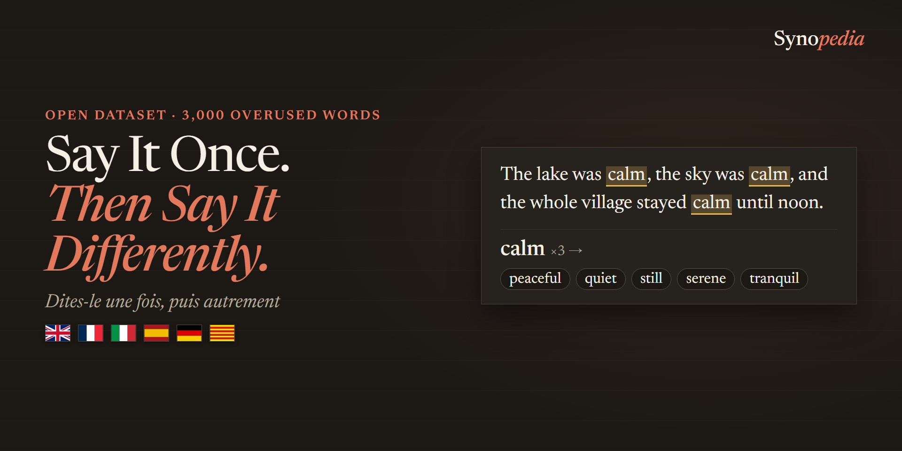

# Overused Words And Synonyms In 6 Languages



**English first, version française complète plus bas. In breve in italiano, en resumen en español, kurz auf Deutsch i en resum en català à la fin.**

## The Words Writers Repeat Most, With Alternatives

Good, good, good. Every editor has crossed out the same word three times in a paragraph. This dataset lists the **500 content words people repeat most** in English, French, Italian, Spanish, German and Catalan, and gives each one **up to 5 common alternatives**, with the same columns in every language.

Repetition is the first thing teachers and editors flag, and the first thing writing assistants try to fix. Yet there is no open multilingual list of the words that come back most often and of what can replace them. Here it is, for six languages.

The alternatives come from [Synopedia](https://www.synopedia.com/), a free multilingual dictionary of synonyms and antonyms, and from the same lists that power its free [Repeated Word Finder](https://www.synopedia.com/browser-extension) extension and [Google Docs add-on](https://www.synopedia.com/google-docs-add-on). Each word links to its full page on Synopedia, with synonyms grouped by meaning, antonyms and definitions.


### Synopedia In Your Language

| Language | Synopedia | Synonyms index |
|---|---|---|
| English | [synopedia.com](https://www.synopedia.com/) | [Synonyms A to Z](https://www.synopedia.com/synonyms/) |
| Français | [synopedia.com/fr](https://www.synopedia.com/fr/) | [Synonymes de A à Z](https://www.synopedia.com/fr/synonymes/) |
| Italiano | [synopedia.com/it](https://www.synopedia.com/it/) | [Sinonimi dalla A alla Z](https://www.synopedia.com/it/sinonimi/) |
| Español | [synopedia.com/es](https://www.synopedia.com/es/) | [Sinónimos de la A a la Z](https://www.synopedia.com/es/sinonimos/) |
| Deutsch | [synopedia.com/de](https://www.synopedia.com/de/) | [Synonyme von A bis Z](https://www.synopedia.com/de/synonyme/) |
| Català | [synopedia.com/ca](https://www.synopedia.com/ca/) | [Sinònims de la A a la Z](https://www.synopedia.com/ca/sinonims/) |

### What Is In The File

| | |
|---|---|
| Words | 3,000, 500 per language |
| Alternatives | Up to 5 per word, most common first |
| Parts of speech | Nouns, verbs, adjectives and adverbs, no function words |
| File | `overused_words_sample.csv`, all six languages, filter on `language` |

A few rows.

| language | word | alternatives |
|---|---|---|
| en | time | day, moment, space, period, schedule |
| fr | dire | penser, expliquer, raconter, admettre, prononcer |
| it | parte | regione, zona, pezzo, porzione, faccia |
| de | gut | positiv, günstig, fein, angenehm, gesund |
| ca | gran | important, enorme, ampli, immens, primer |

### Load It In One Line

```python
from datasets import load_dataset

data = load_dataset("synopedia/overused-words-6-languages")          # all six languages
fr = load_dataset("synopedia/overused-words-6-languages", "fr")    # one language, en fr it es de ca
```

Also on Kaggle, with a ready-to-run notebook, **[Overused Words And Synonyms In 6 Languages on Kaggle](https://www.kaggle.com/datasets/cuivrax/overused-words-6-languages)**.

### Columns

| column | description |
|---|---|
| `language` | ISO 639-1 code, `en`, `fr`, `it`, `es`, `de` or `ca` |
| `word` | The headword, a lemma |
| `part_of_speech` | `noun`, `verb`, `adjective` or `adverb` |
| `alternatives` | Up to 5 common synonyms separated by `\|`, most common first |
| `frequency_rank` | Rank of the word in its language, 1 being the most frequent in written use |
| `url` | The word's page on Synopedia, with synonyms grouped by meaning |

### How It Was Made

Words are lemmas of nouns, verbs, adjectives and adverbs, ranked by written frequency, book frequencies (Lexique 3.83) for French and wordfreq for the other languages. Function words such as articles, pronouns and auxiliaries are excluded, using the same lists as the Synopedia extensions. Alternatives are the most common synonyms shown on Synopedia, and each one was traced back to at least one source whose licence allows sharing under CC BY-SA 4.0. Vulgar, sexual and offensive words were removed from this public sample.

### What You Can Do With It

- **Build a repeated word checker** for an editor, a CMS or a chatbot, and suggest a replacement for each repeat.
- **Measure lexical diversity** in essays, articles or generated text, word by word and language by language.
- **Teach vocabulary.** Start learners with the 500 words they will meet most, and the words that can stand in for them.
- **Benchmark synonym choice.** Ask a language model to pick the alternative that fits a sentence and compare.

The [quickstart notebook on Kaggle](https://www.kaggle.com/code/cuivrax/overused-words-in-6-languages-quickstart) loads the file and builds a working repeated word checker in fifteen lines.

Prefer Colab? The same starter runs in **[Google Colab](https://colab.research.google.com/drive/1277Z_sxxpX0AzJ-MnLx-XaPK8WS24KaA)**, the data loads straight from Hugging Face.

See it at work in the free **[Repeated Word Finder](https://huggingface.co/spaces/synopedia/repeated-word-finder)** app on Hugging Face, which uses this data in six languages.

### Limits

Alternatives are not split by meaning, so for a word with several senses they may mix them (*savoir* gives *comprendre* and *connaître*). Pick the one that fits the context, or use the meaning groups on Synopedia. Some German lists are shorter, because sources with an incompatible licence were left out. The lists were built automatically with partial human review. Corrections are welcome through [Synopedia](https://www.synopedia.com/contact).

### Licence And Citation

**CC BY-SA 4.0.** You can use, share and adapt this data, including for commercial use, if you credit **Synopedia** with a link to **[synopedia.com](https://www.synopedia.com/)** and share your changes under the same licence.

```
Synopedia (2026). Overused Words And Synonyms In 6 Languages [Data set]. https://www.synopedia.com/
```

Built from open sources, with thanks to Wiktionary (CC BY-SA 4.0), JeuxDeMots (CC0), RL-fr by ATILF (CC BY 4.0), Open English WordNet (CC BY 4.0), Softcatalà (CC BY 4.0), MultiWordNet and MCR through Open Multilingual Wordnet (CC BY 3.0) and public domain dictionaries. Full list on [synopedia.com/sources](https://www.synopedia.com/sources).

Companion dataset, **[Antonyms In 6 Languages | Contraires En 6 Langues](https://huggingface.co/datasets/synopedia/antonyms-6-languages)**, 6,000 antonym pairs for the most frequent words.

---

## Version Française

## Les Mots Qu'On Répète Le Plus, Et Par Quoi Les Remplacer

Bien, bien, bien. Tout relecteur a déjà barré trois fois le même mot dans un paragraphe. Ce jeu donne les **500 mots pleins les plus répétés** en anglais, français, italien, espagnol, allemand et catalan, avec pour chacun **jusqu'à 5 alternatives courantes**, et les mêmes colonnes dans chaque langue.

La répétition est la première chose que relèvent les professeurs et les correcteurs, et la première que les assistants d'écriture tentent de corriger. Il n'existait pourtant aucune liste ouverte et multilingue des mots qui reviennent le plus et de ce qui peut les remplacer. La voici, pour six langues.

Les alternatives viennent de [Synopedia](https://www.synopedia.com/fr/), un dictionnaire gratuit des synonymes et des contraires en six langues, et des mêmes listes que son [extension de détection des répétitions](https://www.synopedia.com/fr/extension-navigateur) et son [module Google Docs](https://www.synopedia.com/fr/extension-google-docs), gratuits eux aussi. Chaque mot renvoie à sa page complète sur Synopedia, avec les synonymes classés par sens, les contraires et des définitions.


### Synopedia Dans Votre Langue

| Langue | Synopedia | Index des synonymes |
|---|---|---|
| Français | [synopedia.com/fr](https://www.synopedia.com/fr/) | [Synonymes de A à Z](https://www.synopedia.com/fr/synonymes/) |
| English | [synopedia.com](https://www.synopedia.com/) | [Synonyms A to Z](https://www.synopedia.com/synonyms/) |
| Italiano | [synopedia.com/it](https://www.synopedia.com/it/) | [Sinonimi dalla A alla Z](https://www.synopedia.com/it/sinonimi/) |
| Español | [synopedia.com/es](https://www.synopedia.com/es/) | [Sinónimos de la A a la Z](https://www.synopedia.com/es/sinonimos/) |
| Deutsch | [synopedia.com/de](https://www.synopedia.com/de/) | [Synonyme von A bis Z](https://www.synopedia.com/de/synonyme/) |
| Català | [synopedia.com/ca](https://www.synopedia.com/ca/) | [Sinònims de la A a la Z](https://www.synopedia.com/ca/sinonims/) |

### Contenu Du Fichier

| | |
|---|---|
| Mots | 3 000, 500 par langue |
| Alternatives | Jusqu'à 5 par mot, les plus courantes d'abord |
| Natures | noms, verbes, adjectifs et adverbes, sans mots grammaticaux |
| Fichier | `overused_words_sample.csv`, les six langues, à filtrer sur `language` |

Quelques exemples. dire → penser, expliquer, raconter, admettre, prononcer. time → day, moment, period. parte → regione, zona, pezzo. gut → positiv, günstig, fein.

Aussi sur Kaggle, avec un carnet prêt à lancer, **[Overused Words And Synonyms In 6 Languages sur Kaggle](https://www.kaggle.com/datasets/cuivrax/overused-words-6-languages)**.

### Colonnes

| colonne | description |
|---|---|
| `language` | Code ISO 639-1, `en`, `fr`, `it`, `es`, `de` ou `ca` |
| `word` | Le mot vedette, un lemme |
| `part_of_speech` | `noun` (nom), `verb` (verbe), `adjective` (adjectif) ou `adverb` (adverbe) |
| `alternatives` | Jusqu'à 5 synonymes courants séparés par `\|`, les plus courants d'abord |
| `frequency_rank` | Rang du mot dans sa langue, 1 pour le plus fréquent à l'écrit |
| `url` | La page du mot sur Synopedia, avec les synonymes classés par sens |

### Comment Le Jeu A Été Construit

Les mots sont des lemmes de noms, verbes, adjectifs et adverbes, classés par fréquence à l'écrit, d'après les livres (Lexique 3.83) pour le français et wordfreq pour les autres langues. Les mots grammaticaux, articles, pronoms ou auxiliaires, sont exclus avec les mêmes listes que les extensions Synopedia. Les alternatives sont les synonymes les plus courants affichés sur Synopedia, et chacune a été rattachée à au moins une source dont la licence permet le partage sous CC BY-SA 4.0. Les mots vulgaires, sexuels ou blessants ont été retirés de cet échantillon public.

### À Quoi Ça Sert

- **Construire un détecteur de répétitions** pour un éditeur de texte, un CMS ou un chatbot, et proposer un remplaçant pour chaque répétition.
- **Mesurer la richesse du vocabulaire** dans des copies, des articles ou des textes générés, mot par mot et langue par langue.
- **Enseigner le vocabulaire.** Commencer par les 500 mots qu'on rencontre le plus, et par ceux qui peuvent les remplacer.
- **Évaluer le choix d'un synonyme.** Demander à un modèle de langue l'alternative qui convient à une phrase, et comparer.

Le [carnet de démarrage sur Kaggle](https://www.kaggle.com/code/cuivrax/overused-words-in-6-languages-quickstart) charge le fichier et construit en quinze lignes un détecteur de répétitions qui fonctionne.

Vous préférez Colab ? Le même carnet tourne dans **[Google Colab](https://colab.research.google.com/drive/1277Z_sxxpX0AzJ-MnLx-XaPK8WS24KaA)**, les données se chargent depuis Hugging Face.

À voir en action dans l'application gratuite **[Repeated Word Finder](https://huggingface.co/spaces/synopedia/repeated-word-finder)** sur Hugging Face, qui utilise ces données dans six langues.

### Limites

Les alternatives ne sont pas séparées par sens, elles peuvent donc mêler plusieurs sens d'un même mot (*savoir* donne *comprendre* et *connaître*). Choisissez celle qui convient au contexte, ou consultez les groupes de sens sur Synopedia. Certaines listes allemandes sont plus courtes, les sources sous une licence incompatible ayant été écartées. Les listes ont été construites automatiquement avec une relecture partielle. Les corrections sont bienvenues sur [Synopedia](https://www.synopedia.com/fr/contact).

### Licence Et Citation

**CC BY-SA 4.0.** Vous pouvez utiliser, partager et adapter ces données, y compris pour un usage commercial, en citant **Synopedia** avec un lien vers **[synopedia.com](https://www.synopedia.com/fr/)** et en partageant vos modifications sous la même licence.

Construit à partir de sources ouvertes, avec nos remerciements au Wiktionnaire (CC BY-SA 4.0), à JeuxDeMots (CC0), au RL-fr de l'ATILF (CC BY 4.0), à Open English WordNet (CC BY 4.0), à Softcatalà (CC BY 4.0), à MultiWordNet et au MCR via Open Multilingual Wordnet (CC BY 3.0) et aux dictionnaires du domaine public. Liste complète sur [synopedia.com/fr/sources](https://www.synopedia.com/fr/sources).

Jeu associé, **[Antonyms In 6 Languages | Contraires En 6 Langues](https://huggingface.co/datasets/synopedia/antonyms-6-languages)**, 6 000 paires de contraires pour les mots les plus fréquents.

---

## In Breve

Le **500 parole che si ripetono di più** in sei lingue, ognuna con fino a 5 alternative comuni. Tutti i sinonimi divisi per significato su [Synopedia in italiano](https://www.synopedia.com/it/).

## En Resumen

Las **500 palabras que más se repiten** en seis idiomas, cada una con hasta 5 alternativas comunes. Todos los sinónimos agrupados por significado en [Synopedia en español](https://www.synopedia.com/es/).

## Kurz Gesagt

Die **500 am häufigsten wiederholten Wörter** in sechs Sprachen, jedes mit bis zu 5 gängigen Alternativen. Alle Synonyme nach Bedeutung auf [Synopedia auf Deutsch](https://www.synopedia.com/de/).

## En Resum

Les **500 paraules que més es repeteixen** en sis llengües, cadascuna amb fins a 5 alternatives habituals. Tots els sinònims agrupats per sentit a [Synopedia en català](https://www.synopedia.com/ca/).


---

**Part of [Verbarium](https://github.com/verbarium)**, open word data for word games and language tools. Data by [Synopedia](https://www.synopedia.com/). Also on [Kaggle](https://www.kaggle.com/datasets/cuivrax/overused-words-6-languages) and [Hugging Face](https://huggingface.co/datasets/synopedia/overused-words-6-languages).
